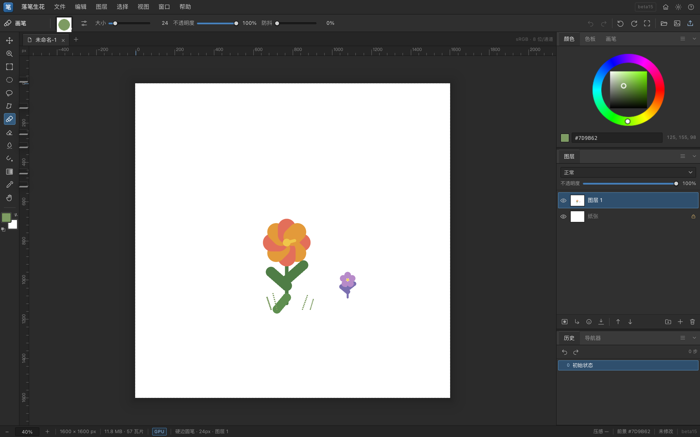

# 落笔生花 Luobishenghua

一款面向绘画的桌面软件：瓦片化图层存储、压感笔刷引擎、PSD 分层互通、`.abr` 笔刷导入、原生工程 `.lbsh`。从 **beta12** 起采用 Photoshop 风格工作台，**beta13** 加入 WebGL2 合成，**beta14** 加入单列工具栏与可拖拽面板标签，**beta15** 把 GPU 合成扩展到组 / 蒙版 / 混合模式。



> 当前版本：**beta15** · 平台：macOS / Windows（Tauri 2）
>
> 技术栈：HTML + CSS + JavaScript（无框架）+ Canvas 2D + Tauri 2（Rust 壳）
>
> 开发：WorkBuddy × likeweixue
>
> 面板 / GPU / 测试协作：DeepSeek（beta12 起）

---

## 功能

- **绘画引擎**：压感画笔 / 橡皮 / 涂抹 / 油漆桶 / 渐变 / 吸管；硬度、流量、防抖、散布、倾斜
- **笔刷生态**：内置硬边圆笔、软边喷枪、铅笔、水彩、橡皮；导入 Photoshop `.abr`
- **图层**：图层组、蒙版、剪贴蒙版、锁定透明像素、混合模式、不透明度、合并 / 盖印 / 拼合
- **大画布**：256×256 瓦片按需分配；空白层 0 开销（4000² × 20 层 + 蒙版约 95 MB）
- **选区 / 变换**：矩形、椭圆、套索、多边形套索，羽化、反选、自由变换、复制粘贴
- **文件**：PSD 分层读写、PNG 导出、`.lbsh` 工程、自动保存、崩溃恢复、最近文件
- **工作台**（beta12）：PS 式工具栏 / 选项栏 / 文档标签 / 标尺 / 面板坞 / 状态栏，可折叠与调整面板，浮动画笔面板，PS 风格拾色器
- **面板坞**（beta14）：单列工具栏；标签可在颜色 / 图层 / 历史三个组之间拖拽重排、跨组停靠；浮动面板拖到标签栏即可并入；标签拖出画布即浮动；布局持久化
- **GPU 合成**（beta13/15）：WebGL2 平铺图层渲染，平移 / 缩放 / 旋转不再每帧走 Canvas2D；beta15 支持图层组、图层 / 组蒙版、正片叠底 / 滤色 / 叠加 / 柔光 / 变暗 / 变亮 / 颜色减淡 / 线性减淡；剪贴蒙版 / 层级过深 / 超大瓦片自动回退，状态栏与「视图」菜单可见

## 照片级界面说明

beta12 按 Photoshop 的工作区逻辑重排；beta13 加入 GPU 合成；beta14 把面板变成真正可拖拽的标签组；beta15 扩展 GPU 组 / 蒙版 / 混合：

- 顶部：菜单栏 + 工具选项栏
- 左侧：单列工具栏 + 前后景色井（24px 工具按钮，40px 宽）
- 中间：文档标签、标尺、画布
- 右侧：颜色 / 色板、图层、历史 / 导航器 三个标签组，可拖动分隔条调高度、拖左边缘调宽度
- 面板标签可拖到任意组重排，浮动面板可停靠进标签组；空组保留 29px 投放条
- 底部：缩放、文档尺寸、内存、笔刷、压感、颜色、保存状态

面板布局、组归属、宽度、高度、浮动位置、标尺开关、色板、GPU 开关都会保存在 `localStorage`，可通过「窗口 → 重置工作区」恢复默认。拖拽标签 / 浮动面板标题即可重组面板。

### GPU 合成

- **简单路径**：普通图层 + 正常混合 + 无蒙版 / 无组时直接绘制到默认帧缓冲，最快
- **复杂路径**：图层组、图层 / 组蒙版、非正常混合走 screen-size FBO 合成；组先渲染到独立 FBO，再按不透明度 / 蒙版 / 混合模式并回父级；组嵌套上限 4 层
- **支持的混合模式**：正片叠底 / 滤色 / 叠加 / 柔光 / 变暗 / 变亮 / 颜色减淡 / 线性减淡（lighter）；图层蒙版在瓦片 shader 中按 alpha 采样，组蒙版用 destination-in 乘到组 FBO
- **回退**：剪贴蒙版、组嵌套 >4、瓦片数 >800 或像素 >200 MB 自动回退 Canvas2D，功能不受影响
- 瓦片按修订号增量上传纹理，笔画只重传改动的瓦片；平移 / 缩放 / 旋转只做一次 GPU 绘制
- 状态栏右侧显示 `GPU` / `CPU`；「视图 → GPU 合成（组 / 蒙版 / 混合）」可手动开关，`localStorage` 记忆
- 基准（本机 M2，4000² / 20 层稀疏 / 144 MB，简单路径）：整屏合成 Canvas2D ≈ 18.5 ms → GPU ≈ 0.2 ms；视图重绘 ≈ 19 ms → 0.3 ms。复杂路径会多几次全屏 FBO pass，数字受文档、GPU、浏览器影响，仅作参考

## 开发

环境要求：

- Node.js 22+
- Rust stable
- macOS：Xcode Command Line Tools；Windows：WebView2 + MSVC Build Tools

```bash
npm install

# 只预览前端（不需要 Rust；零依赖静态服务器）
npm run dev:web
# 打开 http://127.0.0.1:8619/app/
# 加 ?nohome=1 可跳过首页，直接进入工作台（截图 / 调试用）

# 桌面开发模式（Tauri，会自动启动上面的静态服务器）
npm run tauri dev

# 打包
npm run tauri build
```

macOS 产物在 `src-tauri/target/release/bundle/macos/`（`.app`）与 `bundle/dmg/`（`.dmg`），Windows 在 `src-tauri/target/release/bundle/nsis/`。CI 会把它们统一命名为 `luobishenghua-<ref>-macos.dmg` / `.app.zip` / `windows.exe` 后上传和发版。

> 当前安装包未做 Apple 公证 / Windows 代码签名，首次打开可能需要在系统设置中放行。

> GPU 合成要求 WebGL2；不支持的环境自动使用 Canvas2D，不会影响使用。复杂路径的 FBO 还会占用少量显存，剪贴蒙版仍走 CPU。

## GitHub 打包 / 发版

CI 配置：`.github/workflows/build.yml`

- 推送到 `main`：自动构建 macOS `.app` 与 Windows `.exe`，作为 Actions artifact 上传
- 推送 `v*` 标签：自动构建并把安装包附到 GitHub Release

每次迭代建议的流程：

```bash
git add -A
git commit -m "beta15: 具体改动"
git tag -a v0.1.0-beta15 -m "落笔生花 beta15"
git push origin main
git push origin v0.1.0-beta15
```

> 标签必须以 `v` 开头才会触发 Release。版本号建议与 `CHANGELOG.md` 的 betaN 对应。

## 目录结构

```
app/                前端（无构建步骤，直接由 Tauri 加载）
  index.html        工作台 DOM + SVG 图标 sprite
  css/style.css     Photoshop 深色主题
  js/main.js        主程序：工具、颜色、图层、历史、菜单接线
  js/dock.js        面板坞：标签组、折叠、分隔条、浮动面板
  js/colorpicker.js PS 风格拾色器（HSV/RGB/Hex）
  js/rulers.js      标尺
  js/engine.js      Canvas 2D / WebGL2 视图与合成引擎
  js/gpu.js         WebGL2 瓦片合成器（简单 / 组 / 蒙版 / 混合 FBO 路径）
  js/tiles.js       256×256 瓦片图层存储
  js/layers.js      图层树 / 组 / 蒙版 / 剪贴
  js/psd.js         PSD 读写
  js/abr.js         .abr 解析
  js/brushes.js     笔刷印章与压感模型
src-tauri/          Tauri 2 壳（窗口、原生文件对话框、打包配置）
test-*.html         浏览器端引擎 / 图层 / PSD / GPU 测试页（test-gpu.html 62 项）
bench.html          Canvas2D 基准
bench-gpu.html      GPU vs Canvas2D 基准
docs/               文档与截图
```

## 已知限制与路线图

- 渲染仍在 Canvas 2D；超大画布 / 高刷笔迹需要 WebGL2/WebGPU 合成与笔刷批量绘制（GPU 简单图层 / 组 / 蒙版 / 混合已落地，draw call 批处理与笔刷 GPU 化待做）
- 颜色管理仅 sRGB 8 位/通道，暂无 ICC / 16 位
- 单一文档窗口；无多文档标签、无液化 / 滤镜
- 面板仍是三个固定坞组：标签可组间拖拽 / 停靠，浮动面板可并入标签组，但尚未实现任意新建 / 拆分坞组（PS 的 group 全行为）
- 测试以浏览器测试页 + 无头 Chrome 冒烟为主，尚未接入自动化 CI 测试
- GPU 已支持普通图层 / 组 / 蒙版 / 8 种混合模式；剪贴蒙版、组嵌套 >4 层和超大瓦片仍回退 CPU，下一步做 draw call 批处理 / 纹理图集与笔刷 GPU 化
- 文档空闲时仍会用 Canvas2D 合成一份 `engine.doc` 供导航器 / 吸管使用，复杂文档会有一次短暂空闲开销

技术栈评估与演进建议见 [docs/TECH_STACK.md](docs/TECH_STACK.md)。

## 许可

私人项目，暂未选择开源许可证。除非作者另行说明，保留所有权利。
